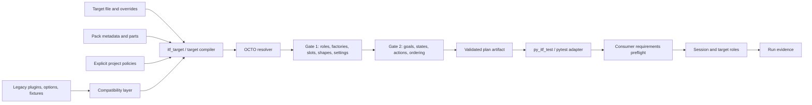
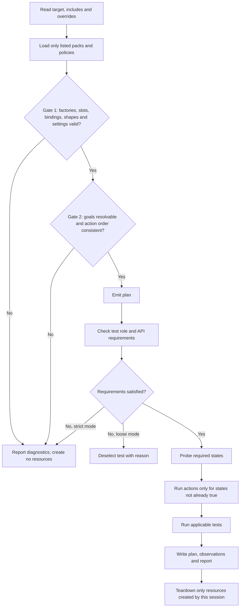
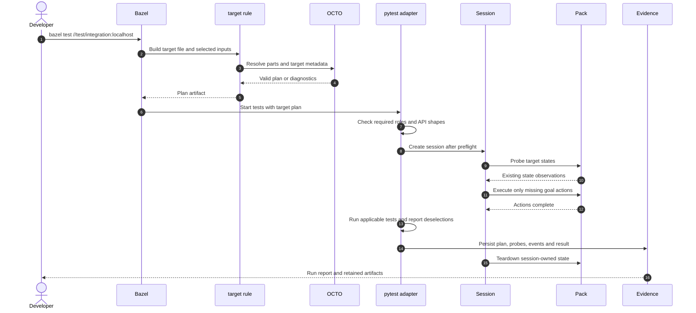

## Context

See [proposal.md](proposal.md) for the motivation and scope. The design must preserve old test entry points,
while allowing target-file tests to use the same composed target/session engine. Target planning is host-side
and must not start Docker, QEMU or device resources.

## Goals / Non-Goals

**Goals:** keep composition validation separate from side-effecting execution; make the plan the boundary
between build-time checks and runtime sessions; wrap both native targets and compatibility targets with a
project-owned API where requested.

**Non-Goals:** prescribe the final package layout or release/PR ordering; make a custom subclass auto-discovered
by pytest; or remove compatibility support as part of this design.

## Architecture



The plan is data, not a live target. `itf validate`, `itf plan`, `itf graph` and Bazel analysis can inspect it
without connecting to Docker, QEMU or a device. Resource creation starts only when a session executes the plan.

## Resolution And Execution Flow



## Test Session Sequence



## Concrete Example

This is the shipped localhost target shape: policy selection and pack mapping are explicit, and the role
`command` is supplied by `localhost.exec`.

```yaml
policies:
  - test/integration/targets/policy.py
packs:
  localhost: score.itf.packs.localhost.plugin
capabilities:
  platform: localhost.platform
  command: localhost.exec
  process: localhost.process
  files: localhost.files
goals:
  - platform.up
```

A test owns the API it needs. The same test body can run against any target whose `command` role accepts this
shape; a target without that role deselects the test with an explanation.

```python
from typing import Protocol
import score.itf as itf

class Command(Protocol):
    __contract__ = "exec.command"

    def exec(self, command: str) -> tuple[int, bytes]: ...

itf_requires = itf.requires("command", shape=Command)

def test_output_and_exit_code_are_returned(target):
    assert target.command.exec("echo -n hello") == (0, b"hello")
```

The contract check is about the call shape the consumer uses. A provider may expose additional operations, but
it must accept the declared call before any test starts.

## Extending The Legacy Target

A project can add a method by subclassing `LegacyTarget`, then export that subclass through a pytest fixture
that wraps the parent `target` fixture. The same fixture pattern works when the parent is the compatibility
target or a native composed target handle:

```python
import pytest
from score.itf.compat.legacy import LegacyTarget

class ProjectTarget(LegacyTarget):
    def project_marker(self):
        return "project-target"

@pytest.fixture
def target(target):
    return ProjectTarget(target)
```

A temporary paired probe ran the same assertions in both modes: the legacy Docker plugin and
`py_itf_test(target = ...)` with a localhost target. Both passed on 12 November 2026. The custom method,
`target.execute(...)`, and `target.command.exec(...)` were available in each. The probe was removed from the
implementation tree after the experiment; it is recorded here as evidence, not shipped as a regression target.
The fixture override is required: the compatibility plugin creates a generic `LegacyTarget` and does not
discover or instantiate a project's subclass by inheritance alone. The subclass is already a facade, so a
separate `itf.Facade` base class is not required for this extension pattern.

## Decisions

- **Resolve before execution** ([octo-planning](specs/octo-planning/spec.md), [bazel-integration](specs/bazel-integration/spec.md)): emit a plan before runtime side effects. An invalid target or strict preflight failure reports diagnostics without starting resources. Alternative: resolve while each plugin starts; rejected because it moves configuration errors into a live run.
- **Explicit composition** ([target-files](specs/target-files/spec.md)): list goals, parts and policies in target data. Alternative: discover policy files from directory names; rejected because target behavior would depend on implicit filesystem conventions.
- **Consumer-owned API shapes** ([consumer-api-gating](specs/consumer-api-gating/spec.md), [contract-conformance](specs/contract-conformance/spec.md)): validate the calls a consumer needs rather than coupling providers to a shared Python interface. Providers may expose more than required.
- **One compatibility boundary** ([legacy-compatibility](specs/legacy-compatibility/spec.md)): adapt old plugins and target methods over the new session engine, with project-specific behavior added through fixture wrapping. Alternative: keep a separate old runtime; rejected because it duplicates lifecycle and resource ownership. See `docs/decisions/DR-002-arch-target-composition.md` for the decision record.
- **Independent run evidence** ([run-evidence](specs/run-evidence/spec.md)): retain plan, probes and outcome so failures can be diagnosed without interpreting console output alone.

## Risks / Trade-offs

- [Migration risk] Existing tests may rely on behavior not represented by mapped roles → retain old entry points and source-hash checks; document known semantic differences.
- [Host-dependent verification] Pcap requires `CAP_NET_RAW`, and QEMU/QNX requires licensed tooling → report these as unverified when prerequisites are absent; see [tasks.md](tasks.md).
- [Coverage overstatement] Focused reruns do not establish a green full suite → list exact commands and results in [tasks.md](tasks.md).

## Failure Paths

- Gate 1 or gate 2 failure: report the invalid role, contract, goal or ordering and create no resources.
- Strict requirement failure: stop before bring-up. Loose mode: deselect the incompatible test with its reason.
- Probe/action failure: record the failing state/action in run evidence; teardown only states acquired by that session.
- Compatibility fixture failure: preserve the default generic `LegacyTarget`; custom behavior is opt-in through the project's fixture, not subclass discovery.

## Migration Plan

No single landing sequence is required by this proposal. For a project adopting the design, keep legacy BUILD
labels and plugins available while migrating target files and tests incrementally. A project can roll back by
pinning its prior ITF version and retaining its existing BUILD/plugin configuration; no external resource
format or persistent data migration is introduced here. Maintainers may choose another sequence as described
in the existing RFC.

## Open Questions

None that change the technical design. The compatibility support period and whether the layer is published as
a separate package are maintainer policy questions listed in [proposal.md](proposal.md).
